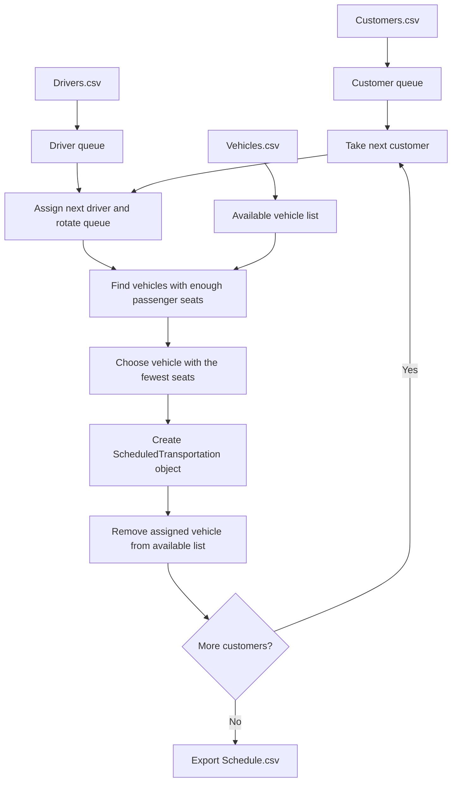

<div align="center">

# 🚘 Airport Rideshare Scheduler

**A Java application that assigns airport pickup requests to drivers and vehicles, then exports a CSV transportation schedule.**


*File I/O · Object-Oriented Programming · Inheritance · Polymorphism · FIFO Queues*

</div>

---

## Overview

**Airport Rideshare Scheduler** processes three CSV inventories—customers, drivers, and vehicles—to produce a transportation schedule. Each customer is paired with the next driver in a rotating queue and the smallest available vehicle that can accommodate their party.

The program runs automatically: it reads the input files, schedules rides, and writes the result to `Schedule.csv`. No interactive input, external library, database, or web service is required.

## Features

| | Feature | Implementation |
|:--:|---|---|
| 📥 | **CSV data loading** | Reads customers, drivers, and vehicles from three input files. |
| 👥 | **Customer classification** | Creates `Customer` or `VIPCustomer` objects according to the rewards-points field (`-1` means regular customer). |
| 🔁 | **Round-robin driver assignment** | Takes the next driver from a FIFO queue and places that driver at the back for future rides. |
| 🚗 | **Capacity-based vehicle selection** | Filters out vehicles with insufficient seats, then chooses the available vehicle with the fewest seats. |
| 🧩 | **Object-oriented data model** | Uses inheritance, interfaces, and `toCSV()` methods to represent and export ride details. |
| 📤 | **CSV schedule export** | Writes a combined customer–driver–vehicle record to `Schedule.csv`. |

> [!NOTE]
> The code distinguishes VIP and regular customers, and stores vehicle luxury status, but **does not currently use either status to prioritize vehicle assignments**. See [Current limitations](#current-limitations).

## Application workflow



### Scheduling rules implemented

1. Process customers in the order they appear in `Customers.csv`.
2. Assign drivers in round-robin order: after each assignment, place that driver at the end of the queue.
3. Consider only vehicles whose passenger-seat capacity is **at least** the customer's party size.
4. Choose the vehicle with the **smallest capacity** among the eligible vehicles. For equal capacities, the first one encountered in the available-vehicle list is selected.
5. Remove each assigned vehicle from the available list; a vehicle is therefore used at most once per execution.
6. Save the completed assignments as a new CSV file.

This is a sequential, capacity-based selection algorithm—not a global optimization algorithm.

## Sample run

The three sample input files contain **11 customers, 5 drivers, and 11 vehicles**. Running the program with these files generates **11 scheduled rides** in `Schedule.csv`. Here are selected records from that generated output:

| Customer | Party size | Assigned driver | Assigned vehicle | Luxury |
|---|---:|---|---|:---:|
| Alice | 2 | Aubrie | Green hybrid with a dog in the front seat | Yes |
| Bob | 3 | Brycen | Green Sedan with mini fridge | Yes |
| Charles | 1 | Carleigh | Red Motorcycle with sidecar | No |
| Ernest | 7 | Elise | Blue SUV with standard kit | No |
| Julia | 1 | Elise | White hybrid standard issue | No |

With this dataset, the five drivers receive **3, 2, 2, 2, and 2 rides**, respectively, demonstrating round-robin rotation.

## Project structure

```text
airport-rideshare-scheduler/
├── Main.java                       # Application entry point and ride scheduling
├── FileHandler.java                # CSV input/output operations
├── Printable.java                  # Shared toCSV() interface
├── Person.java                     # Base person model
├── Customer.java                   # Customer and party-size information
├── VIPCustomer.java                # Customer subtype with rewards points
├── Driver.java                     # Driver model with license information
├── Vehicle.java                    # Vehicle capacity, description, and luxury flag
├── ScheduledTransportation.java    # Customer + driver + vehicle assignment
├── Customers.csv                   # Input: customer data
├── Drivers.csv                     # Input: driver data
├── Vehicles.csv                    # Input: vehicle data
├── assets/
│   ├── UML_Diagram.png       # Original UML, rendered for GitHub display
│   └── UML_Diagram.pdf       # Original UML diagram
└── README.md
```

All nine `.java` classes are in the default package in the supplied code. You can keep them together as shown above, or place the Java files in an Eclipse source folder while keeping the CSV inputs in the application's working directory.

## Object-oriented design

### UML class diagram


[View the original UML diagram (PDF)](assets/UML_Diagram.pdf)

- **Inheritance:** `Customer` and `Driver` extend `Person`; `VIPCustomer` extends `Customer`.
- **Polymorphism:** The customer queue holds both `Customer` and `VIPCustomer` instances, and the scheduler checks subtype using `instanceof`.
- **Interface-based serialization:** `Printable` defines `toCSV()`. The models provide implementations directly or through inheritance, and `ScheduledTransportation.toCSV()` combines the three assigned objects into one output record.
- **Java collections:** `ArrayList<Vehicle>` tracks available vehicles; `Queue<Customer>` and `Queue<Driver>` use `LinkedList`; an `ArrayList<ScheduledTransportation>` stores results.

## Getting started

### Requirements

- Java Development Kit (JDK).
- A terminal or a Java IDE such as Eclipse.
- No third-party dependencies.

### Run from the terminal

Place the nine `.java` files and three input `.csv` files in the same directory. From that directory, run:

```bash
javac *.java
java Main
```

The application reads `Customers.csv`, `Drivers.csv`, and `Vehicles.csv` from the **current working directory**. It then writes (or overwrites) `Schedule.csv` in that directory.

> [!IMPORTANT]
> Running the program normally produces **no success message in the console**. Open the generated `Schedule.csv` to review the assignments. Each run overwrites that file.

### Run in Eclipse

1. Create a Java project and add the nine source files to its `src` folder (default package).
2. Place `Customers.csv`, `Drivers.csv`, and `Vehicles.csv` in the **project root**, not inside `src`.
3. Run `Main.java` as **Java Application**.
4. Refresh the project and open the generated `Schedule.csv` in the project root.

If your Eclipse run configuration uses a different working directory, update it so that the program can find the CSV inputs.

## Input and output files

| File | Purpose | CSV columns, in order |
|---|---|---|
| `Customers.csv` | Customer input | `Name`, `Email`, `Age`, `PartySize`, `Points` |
| `Drivers.csv` | Driver input | `Name`, `Email`, `Age`, `License` |
| `Vehicles.csv` | Vehicle input | `Description`, `Seats`, `Luxury Model` |
| `Schedule.csv` | Generated output (not needed in the repository) | Customer details, driver details, then vehicle details |

The precise **output header** is:

```csv
CustomerName,CustomerAge,CustomerEmail,CustomerPartySize,CustomerPoints,DriverName,DriverAge,DriverEmail,DriverLicense,VehicleDescription,VehicleSeats,VehicleIsLuxury
```

A regular customer has `Points` equal to `-1`; any other points value creates a `VIPCustomer`. The vehicle luxury field is parsed as a Boolean (`true` or `false`; the sample inputs use `TRUE` and `FALSE`).

## Current limitations

The repository documents the program **as currently implemented**, not every feature from its original specification:

- **VIP vehicle preference is not enforced.** The vehicle-selection conditional in `Main.scheduleAllRides()` is always true, so the assignment is based on capacity alone, regardless of customer VIP status or vehicle luxury status.
- **Insufficient resources are not handled safely.** An empty driver queue or the absence of a vehicle large enough for a party can cause a runtime error or an invalid assignment.
- **CSV validation is limited.** Missing files are reported, but malformed rows, nonnumeric values, and other data problems are not comprehensively handled.
- **Vehicle assignment is single-use.** Assigned vehicles are removed from inventory; there is no return-to-service or cleaning cycle.
- **No interactive controls or scheduling timestamps.** Files are processed in a single batch when `Main` runs.

### Possible enhancements

VIP-aware vehicle selection with fallback rules; validation for missing resources and malformed CSV input; clearer run summaries; and a test suite for scheduling edge cases.
